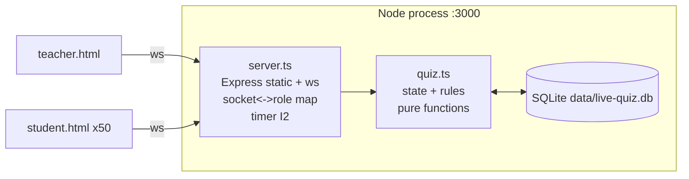

# HLD — live-quiz

> model requested: fable · served: Fable 5.1 (claude-fable-5-1)
> Verified greenfield: `Glob /home/claude/live-quiz/**` → directory does not exist (no existing stack to inherit). Stack ตาม brief `00-brief.md:17-20`

## 1. Context

1 process Node.js บนเครื่องอาจารย์ · นักศึกษา ~50 คนบน LAN เดียวกันเปิด browser · ไม่มี service ภายนอก

## 2. Components

| Component | หน้าที่ | ที่อยู่ |
|---|---|---|
| **Express static server** | เสิร์ฟ `teacher.html`, `student.html`, `GET /questions.json` (รายการโจทย์จาก DB; teacher เท่านั้นที่ใช้) | `src/server.ts` |
| **WebSocket server (ws)** | รับ connection, แปลง JSON ↔ message, จำว่า socket ไหนเป็น teacher/student ชื่ออะไร, ส่ง outbound ไปปลายทาง | `src/server.ts` |
| **Quiz state module** | state ของห้อง + กฎทั้งหมด (join / publish / answer / close) — **ไม่รู้จัก socket** · เขียนทุกการเปลี่ยนแปลงลง SQLite | `src/quiz.ts` |
| **SQLite (`node:sqlite`)** | เก็บโจทย์ นักศึกษา ข้อปัจจุบัน คำตอบ ข้าม restart · SQL อยู่ที่เดียว | `src/db.ts`, `data/live-quiz.db` |
| **Teacher page** | เลือกข้อ → publish · แสดง students + tally · (I2) slider เวลา | `public/teacher.html` |
| **Student page** | ใส่ชื่อ → join · แสดงโจทย์ · ปุ่มตอบ · (I2) นับถอยหลัง | `public/student.html` |

## 3. Diagram



Trust boundary: มีเส้นเดียวคือ **browser ↔ server บน LAN** — ไม่มี auth, ทุก message จาก client ถือว่า untrusted จึง validate ใน `quiz.ts` (choice range, question id, name) · ไม่มี boundary อื่น (DB เป็นไฟล์ local ใน process เดียวกัน/ไม่มี external)

## 4. Data flow (Iteration 1)

```
student  --join{name}-------------> server --> quiz.join()      --> joined (student), students (teacher)
teacher  --publish{questionId}----> server --> quiz.publish()   --> question (all students), tally (teacher)
student  --answer{qid,choice}-----> server --> quiz.answer()    --> answer:accepted|rejected (student), tally (teacher)
socket close ---------------------> server --> quiz.disconnect()--> students (teacher)
```

หลักการ: `server.ts` ทำแค่ I/O (รับ → เรียก `quiz.ts` → ส่งผลลัพธ์ตาม `to`) · `quiz.ts` ไม่ import `ws` เลย จึง unit test ได้โดยไม่ต้องเปิด socket (รับ db handle; test ใช้ `:memory:`) · ตอนสร้าง `quiz` จะโหลด state จาก SQLite และตั้ง `connected=false` ทุกคน

## 5. Data flow เพิ่มใน Iteration 2

```
teacher  --publish{qid,timeLimitSec}--> server --> quiz.publish(qid, {timeLimitSec}) --> question{deadlineAt} (students)
                                        server: clearTimeout(old); d = state.current?.deadlineAt; setTimeout(d - Date.now())
timer fires --------------------------> server --> quiz.closeQuestion(qid) --> question:closed (all)
student  --answer (late)--------------> server --> quiz.answer(now)      --> rejected: closed
```

`now` ถูกส่งเป็น parameter เข้า `quiz.ts` → ทดสอบ "late answer" ได้โดยไม่ต้องรอจริง (ADR-003)

## 6. NFR mapping

- ~50 students: 1 process, 50 sockets, state ขนาดไม่กี่ KB — ไม่ต้อง scale
- Latency ≤ 1 s: push ผ่าน ws ทันทีไม่มี polling (ADR-001)
- Simplicity: 3 ไฟล์ TS (quiz, db, server) + 2 HTML + 1 JSON

## 7. Decisions → ADR

- ADR-001 WebSocket แทน polling
- ADR-002 in-memory state, ไม่มี auth (Superseded by ADR-004 เรื่อง state)
- ADR-004 SQLite state (`node:sqlite`), ยังไม่มี auth (accepted risks)
- ADR-003 (I2) server-authoritative timer
